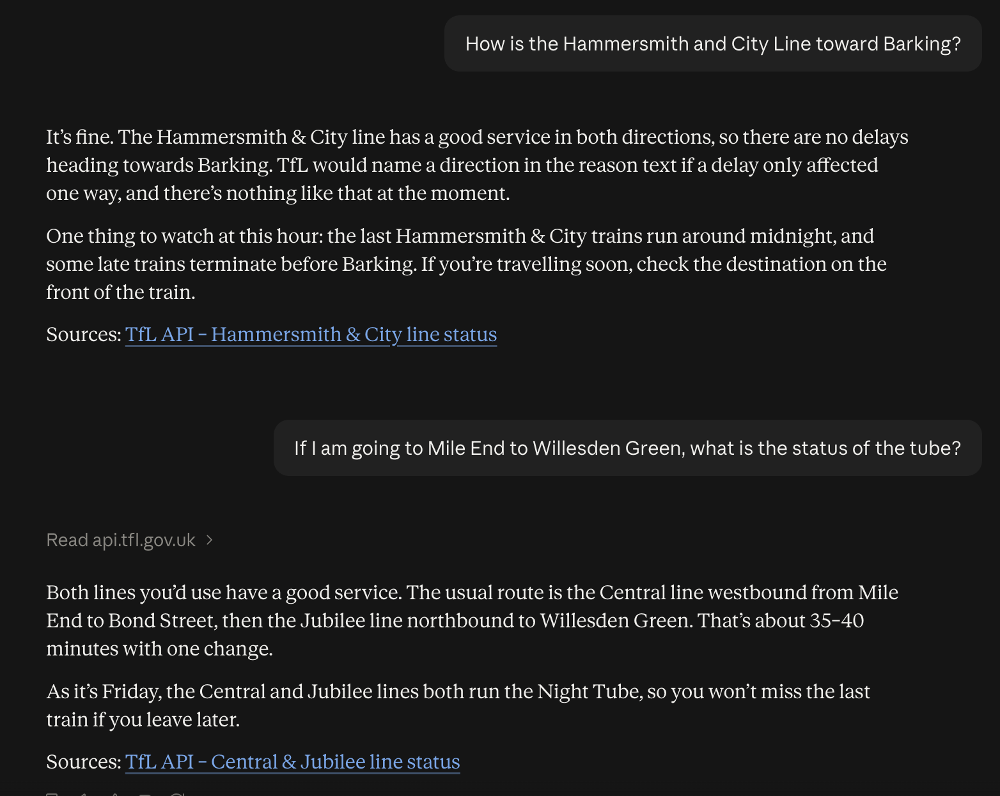

# 🚇 Tube MCP

An [MCP (Model Context Protocol)](https://modelcontextprotocol.io) server that gives Claude live London Underground status from the [TfL Unified API](https://api.tfl.gov.uk).

Ask Claude *"How's the District line right now?"* and it calls this server, which fetches live data from TfL and returns a short, readable summary.



---

## What it does

| Tool | Description |
|---|---|
| `get_line_status` | Live status for a single Tube line (e.g. `district`, `hammersmith-city`), or every Tube line if no line is given |

Example output:

```
District: Good Service
Central: Minor Delays (Due to an earlier signal failure...)
```

## Tech stack

- **Node.js** (20+) and **TypeScript**
- **[@modelcontextprotocol/sdk](https://github.com/modelcontextprotocol/typescript-sdk)**, the official MCP TypeScript SDK
- **Zod** for input schemas and validation
- **TfL Unified API** for live data
- **stdio transport** for local use with Claude Desktop

## How it works

```
You ──▶ Claude Desktop ──(JSON-RPC over stdio)──▶ Tube MCP server ──(HTTPS)──▶ TfL API
```

1. Claude Desktop launches the server as a child process.
2. It asks the server which tools exist (`tools/list`) and receives each tool's name, description and input schema.
3. When a question is relevant, the model calls the tool (`tools/call`) with arguments it chooses, such as `{ "line": "district" }`.
4. The server validates the input, calls TfL, and returns a compact text summary for the model to answer with.

## Getting started

### 1. Install and build

```bash
git clone https://github.com/YOUR-USERNAME/tube-mcp.git
cd tube-mcp
npm install
npm run build
```

### 2. Test with the MCP Inspector

```bash
npx @modelcontextprotocol/inspector node build/index.js
```

Open the Tools tab and run `get_line_status` with `district`, then with no input.

### 3. Connect to Claude Desktop

Add this to `claude_desktop_config.json` as a top-level key, using the absolute path to your build:

```json
{
  "mcpServers": {
    "tube": {
      "command": "node",
      "args": ["/ABSOLUTE/PATH/TO/tube-mcp/build/index.js"]
    }
  }
}
```

Fully quit Claude Desktop (Cmd+Q on macOS) and reopen it. Claude Desktop starts the server automatically, so you don't need to run it yourself.

Try asking:
- "Is the District line running OK?"
- "How's the whole Tube doing right now?"
- "Any problems on the Hammersmith & City line?"

## Design decisions

- **Tool descriptions are written as prompts.** The model relies on them to decide when to call the tool and what to pass, so they include examples of valid line IDs and explain what omitting the input does.
- **Curated output instead of raw JSON.** TfL's response is large. Everything a tool returns goes into the model's context, so the server returns one line per Tube line, which saves tokens and improves answers.
- **Errors the model can act on.** Failures return `isError: true` with a helpful message (e.g. *"Is 'X' a valid line ID?"*) instead of throwing, so the model can correct itself and retry.
- **Model input treated as untrusted.** Arguments are validated against a Zod schema and URL-encoded before being used in a request.
- **Logs go to stderr.** With stdio transport, stdout is the protocol channel, so `console.log` would corrupt messages. The server logs with `console.error`.

## Project structure

```
tube-mcp/
├── src/
│   └── index.ts      # Server setup and tool definitions
├── build/            # Compiled output (git-ignored)
├── package.json
└── tsconfig.json
```

## Debugging

Claude Desktop writes server logs on macOS to:

```bash
tail -n 50 ~/Library/Logs/Claude/mcp-server-tube.log
```

After changing code, run `npm run build` and fully restart Claude Desktop, because it runs the compiled `build/index.js`.

## Roadmap

- [x] `get_line_status`: live line status
- [ ] `next_arrivals`: next trains at a station, with fuzzy station name matching
- [ ] `plan_journey`: routes between two places, with lines to avoid
- [ ] `tfl://lines` resource and a "morning commute" prompt
- [ ] Response validation with Zod, caching and a TfL app key
- [ ] Stateless remote deployment on AWS Lambda (MCP spec 2026-07-28)
- [ ] MCP App: a live departures-board widget

## Acknowledgements

Powered by TfL Open Data. Contains OS data © Crown copyright and database rights.